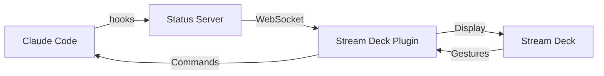

## Architecture

AgentDeck consists of several components that work together to provide real-time monitoring and control of AI assistants.

## Data Flow



The data flows through the system:

1. **AI Assistant** triggers hooks on state changes
2. **Hook Script** sends status to the Status Server
3. **Status Server** broadcasts via WebSocket
4. **Stream Deck Plugin** receives updates and displays icons
5. **User gestures** flow back to control the AI

## Components

### Plugin Entry (`src/plugin.ts`)

The main entry point that:
- Initializes the Stream Deck SDK
- Starts the status server
- Registers the ClaudeInstanceAction

### Status Server (`src/server/status-server.ts`)

HTTP and WebSocket server running on port **19847**:

| Endpoint | Method | Description |
| -------- | ------ | ----------- |
| `/status` | POST | Receives status updates from hooks |
| `/instances` | GET | Returns all tracked instances |
| `/health` | GET | Health check endpoint |
| WebSocket | - | Real-time bidirectional communication |

### Instance Manager (`src/server/instance-manager.ts`)

Tracks state of all AI sessions:
- Maintains state map by session ID
- Handles state transitions
- Cleans up disconnected sessions

### Claude Instance Action (`src/actions/claude-instance-action.ts`)

Main Stream Deck action implementing:
- WebSocket client connecting to status server
- Interaction handling (single press, double press, hold)
- Animation controller integration
- Property Inspector communication

### Icon System (`src/icons/`)

| File | Purpose |
| ---- | ------- |
| `icon-generator.ts` | Generates SVG icons for each state |
| `animation-controller.ts` | Controls frame-based animations at 10 FPS |

### Terminal Utilities (`src/utils/`)

| File | Purpose |
| ---- | ------- |
| `terminal-focus.ts` | AppleScript/PowerShell for focusing terminals |
| `kitty-remote.ts` | Kitty terminal remote control via `kitten @` |
| `interaction-handler.ts` | Gesture detection logic |

## State Types

Defined in `src/server/types.ts`:

```typescript
type InstanceState =
  | 'idle'
  | 'running'
  | 'tool_use'
  | 'editing'
  | 'question'
  | 'permission'
  | 'error'
  | 'disconnected'
```

## Hook Integration

The `hooks/status-reporter.sh` script maps hook events to states:

| Event/Tool | State |
| ---------- | ----- |
| Edit, Write | `editing` |
| Bash, Read, Glob, Grep | `tool_use` |
| Task, AskUserQuestion | `question` |
| PermissionRequest | `permission` |

## Plugin Package Structure

```
com.agentdeck.plugin.sdPlugin/
├── manifest.json      # Plugin metadata
├── bin/
│   └── plugin.js      # Rollup-bundled output
├── ui/
│   └── claude-instance.html  # Property Inspector
└── imgs/
    └── *.svg          # Icons
```

## Build Process

AgentDeck uses Rollup to bundle the TypeScript source:

```bash
pnpm build    # One-time build
pnpm watch    # Watch mode
```

The build outputs to `com.agentdeck.plugin.sdPlugin/bin/plugin.js`.

## Stream Deck SDK

AgentDeck uses the official [@elgato/streamdeck](https://www.npmjs.com/package/@elgato/streamdeck) SDK which provides:

- Action registration
- Settings persistence
- Property Inspector communication
- Key image updates
- Event handling

## Next Steps

- Check [Troubleshooting](/docs/troubleshooting) for common issues
